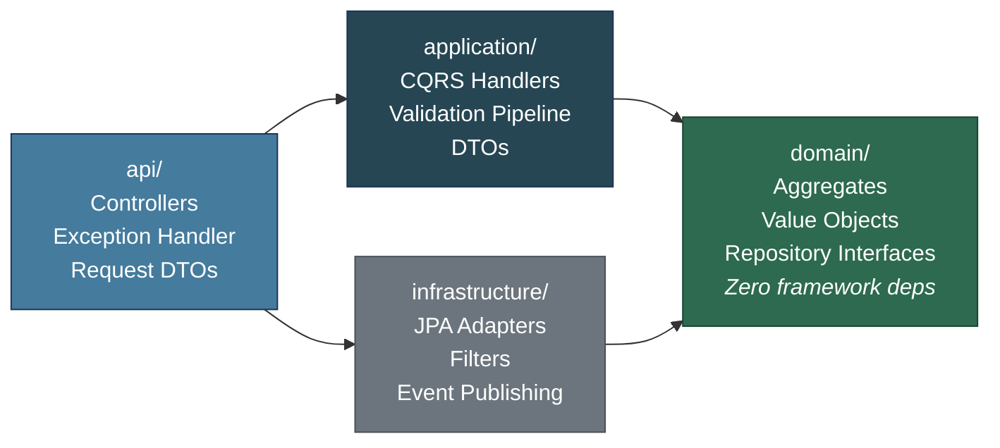
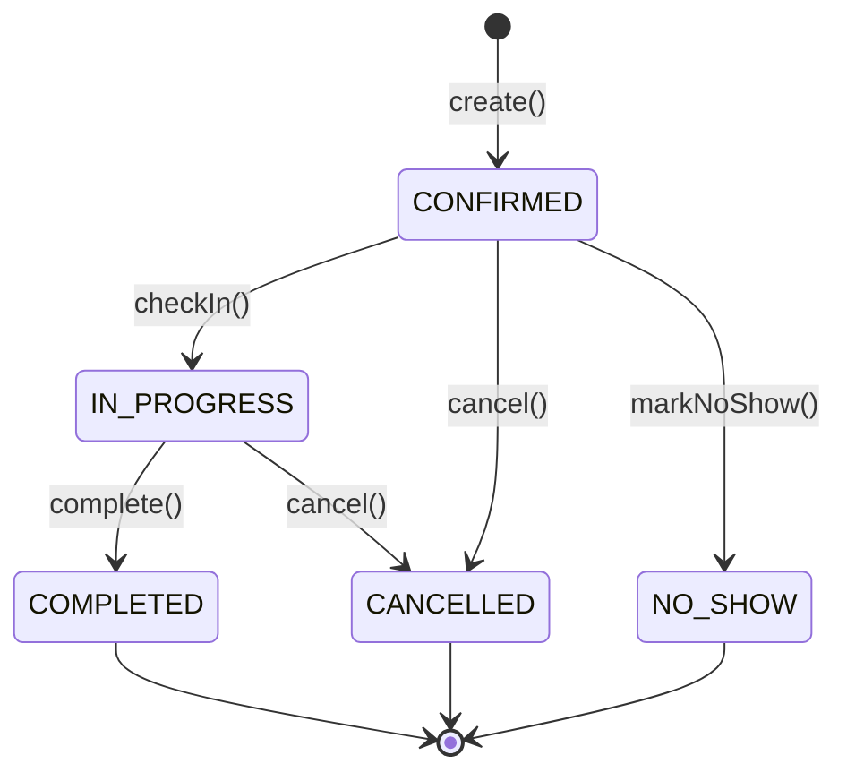
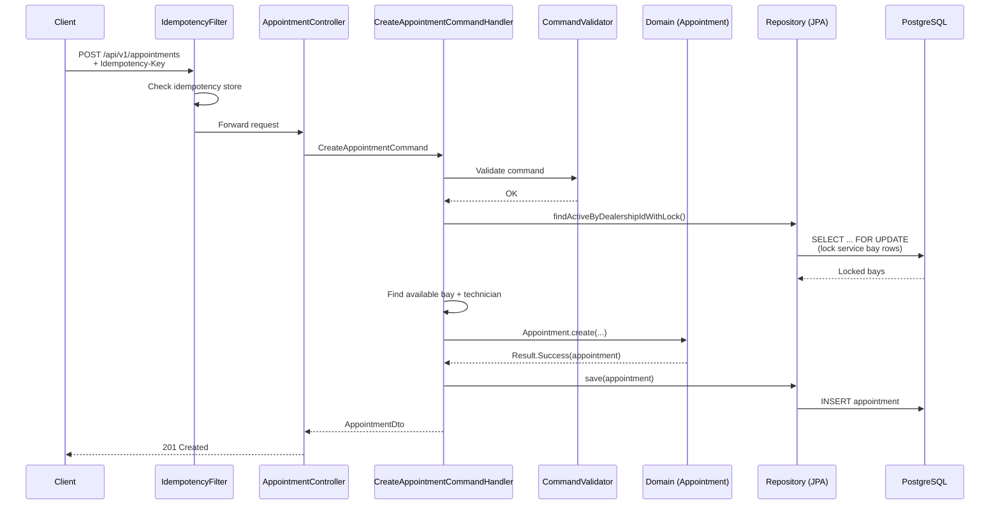
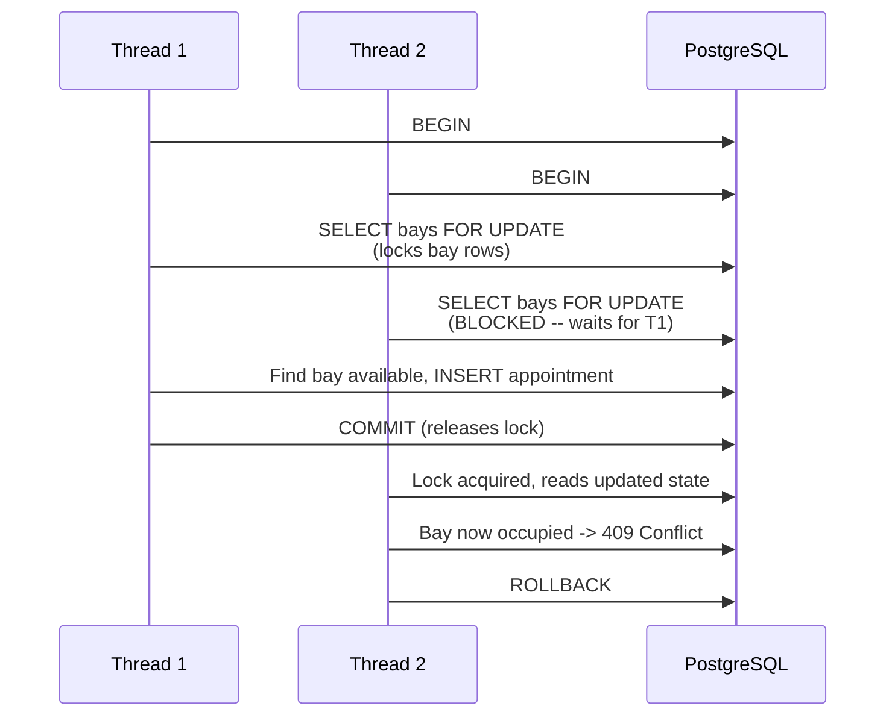
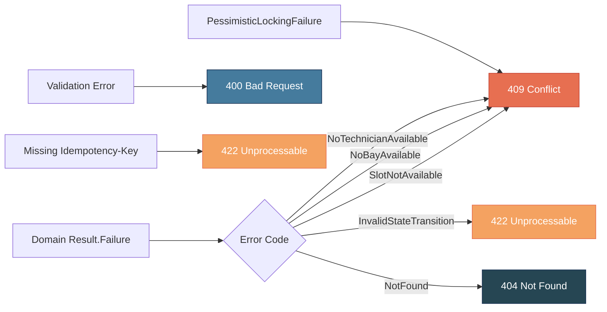
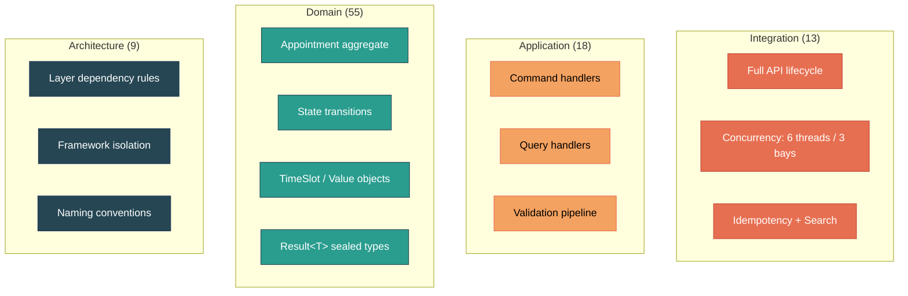
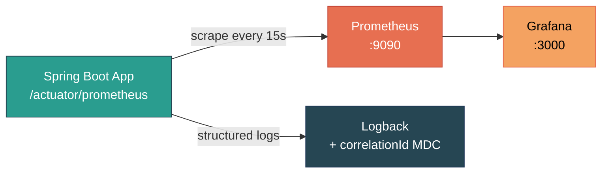
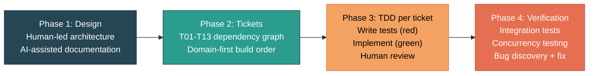

# Unified Service Scheduler

> **Keyloop Technical Assessment -- Scenario A (Domain: Ownership)**

A scheduling system for automotive dealerships that manages service appointments, technician assignments, service bay allocation, and real-time availability queries. The system prevents double-booking through pessimistic locking and enforces appointment lifecycle state transitions.

## Architecture

Clean Architecture with 4 layers, enforced by **9 ArchUnit rules** at build time:



**Dependency rule**: `domain` has zero framework dependencies -- `jakarta.persistence` and `org.springframework` are forbidden, enforced by ArchUnit at build time. `application` depends only on `domain`. `infrastructure` implements domain ports (repository interfaces). `api` orchestrates everything.

### Appointment Lifecycle (State Machine)



### Request Flow (Create Appointment)



### Double-Booking Prevention (Concurrency Deep Dive)



The lock targets **service bay rows** (not appointment rows) because bay rows always exist. Locking appointment rows would fail on empty slots (nothing to lock = phantom read vulnerability).

See [`docs/02-design.md`](./docs/02-design.md) for the full system design document with additional diagrams, concurrency analysis, and the availability algorithm.

## Tech Stack

| Category | Technology | Justification |
|----------|-----------|---------------|
| Language | Java 21 (Virtual Threads) | Modern LTS, structured concurrency, pattern matching |
| Framework | Spring Boot 3.3.5 | Mature ecosystem, Actuator, auto-configuration |
| Database | PostgreSQL 16 | ACID guarantees, `FOR UPDATE` locking, JSONB support |
| Migrations | Flyway (V1-V6) | Version-controlled schema, repeatable migrations |
| Build | Maven | Standard Java build, dependency management |
| Unit Tests | JUnit 5 + AssertJ + Mockito | Industry standard, fluent assertions |
| Integration Tests | Testcontainers | Real PostgreSQL in tests, no mocking the database |
| Architecture Tests | ArchUnit | Compile-time layer dependency enforcement |
| API Docs | SpringDoc OpenAPI / Swagger UI | Auto-generated from annotations, interactive testing |
| Metrics | Micrometer + Prometheus | Dimensional metrics, Prometheus scraping |
| Dashboard | Grafana (auto-provisioned) | Pre-configured dashboard with 15 panels |
| Logging | SLF4J/Logback + CorrelationId MDC | Structured logging with request tracing |

See [`docs/03-tech-stack.md`](./docs/03-tech-stack.md) for detailed technology choices and justifications.

## Prerequisites

- Java 21 (Eclipse Temurin recommended)
- Docker + Docker Compose
- Maven 3.9+

## Quick Start

### Full Stack with Monitoring

```bash
docker compose up -d postgres           # Start PostgreSQL
mvn spring-boot:run                     # Start the app (port 8080)
docker compose up -d prometheus grafana # Start monitoring stack
```

| Service | URL | Credentials |
|---------|-----|-------------|
| Application | http://localhost:8080 | -- |
| Swagger UI | http://localhost:8080/swagger-ui.html | -- |
| Health Check | http://localhost:8080/actuator/health | -- |
| Prometheus | http://localhost:9090 | -- |
| Grafana Dashboard | http://localhost:3000/d/unified-scheduler | admin / admin |

### App Only (without monitoring)

```bash
docker compose up -d postgres   # Start PostgreSQL only
mvn spring-boot:run             # Start the app
```

Seed data (6 sample appointments across all statuses) is loaded automatically via Flyway V6.

## API Endpoints

| Method | Endpoint | Description | Success | Error Codes |
|--------|----------|-------------|---------|-------------|
| `POST` | `/api/v1/appointments` | Create appointment | 201 | 400, 409, 422 |
| `GET` | `/api/v1/appointments/{id}` | Get by ID | 200 | 404 |
| `DELETE` | `/api/v1/appointments/{id}` | Cancel | 204 | 404, 422 |
| `PATCH` | `/api/v1/appointments/{id}/check-in` | Check in customer | 204 | 404, 422 |
| `PATCH` | `/api/v1/appointments/{id}/complete` | Complete service | 204 | 404, 422 |
| `PATCH` | `/api/v1/appointments/{id}/no-show` | Mark no-show | 204 | 404, 422 |
| `GET` | `/api/v1/appointments` | Search (paginated) | 200 | -- |
| `GET` | `/api/v1/dealerships/{id}/availability` | Available slots | 200 | 400 |

All error responses follow **RFC 7807 Problem Detail**. `POST` requires an `Idempotency-Key` header (24h TTL).

### Error Mapping



## Testing

```bash
mvn test                                              # Full suite (requires Docker)
mvn test -Dtest="com.keyloop.scheduler.domain.**"     # Domain only (no Docker)
```

### Test Suite (98 tests)

| Category | Count | Scope |
|----------|-------|-------|
| Domain unit tests | 55 | Appointment aggregate, TimeSlot, AppointmentStatus state machine, Result\<T\>, entity hierarchy |
| Application handler tests | 18 | CQRS command/query handlers, validation pipeline (Mockito) |
| Infrastructure tests | 3 | CorrelationIdFilter behavior |
| Architecture tests | 9 | ArchUnit: 4 layer rules, 2 framework isolation, 3 naming conventions |
| Integration tests | 13 | Testcontainers + real PostgreSQL: full lifecycle, idempotency, search, concurrency |

### Test Pyramid



The concurrency integration test spawns **6 threads** competing for **3 service bays** simultaneously -- exactly 3 succeed (201) and 3 are rejected (409), validating the pessimistic locking strategy.

## Key Design Decisions

| Decision | Approach | Rationale |
|----------|----------|-----------|
| Double-booking prevention | `SELECT ... FOR UPDATE` on **service bay rows** | Prevents phantom reads -- bay rows always exist, so the lock serializes even when no prior appointments exist for a slot |
| CQRS | Command + Handler / Query + Handler | Single-responsibility handlers, clear read/write separation |
| Result\<T\> | Sealed `Success`/`Failure` types | Business-rule failures are values, not exceptions; boundary errors (404, 400) still use exceptions mapped to RFC 7807 |
| Strongly-typed IDs | `CustomerId`, `VehicleId`, `AppointmentId` | Compile-time safety; anti-corruption boundary at the handler layer |
| Clock injection | `java.time.Clock` via constructor | Deterministic tests with `Clock.fixed(...)`, no hidden `now()` calls |
| Idempotency | `Idempotency-Key` header + DB store | Safe retries for POST, 24h TTL with scheduled cleanup |
| Audit + soft delete | `AuditableEntity` / `SoftDeletableEntity` | Consistent `createdAt`, `updatedAt`, `deleted` across all entities |
| Correlation ID | `CorrelationIdFilter` + MDC | UUID propagated through all log lines for end-to-end request tracing |

## Observability



### Metrics Pipeline

The application exposes metrics via **Micrometer + Prometheus registry**, scraped every 15 seconds by Prometheus. A pre-configured Grafana dashboard auto-provisions on startup.

### Grafana Dashboard (15 panels)

| Section | Panels |
|---------|--------|
| HTTP Overview | Request Rate, Response Time p95, Total Requests, Error Rate (5xx), Avg Response Time, 409 Conflicts |
| JVM | Heap Memory, Threads (live/daemon/peak), GC Pause Count, GC Pause Duration |
| Database (HikariCP) | Connection Pool (active/idle/total/pending), Connection Acquire Time |
| Business Metrics | Appointment API Calls by Endpoint, HTTP Status Distribution, Latency percentiles (p50/p95/p99) |

### Actuator Endpoints

| Endpoint | Description |
|----------|-------------|
| `/actuator/health` | Application health (DB, disk, detailed) |
| `/actuator/prometheus` | Prometheus-format metrics |
| `/actuator/metrics` | JSON metrics catalog |
| `/actuator/flyway` | Migration status |
| `/actuator/scheduledtasks` | Scheduled jobs (idempotency cleanup) |

### Structured Logging

All log output includes `correlationId` in MDC for request tracing. Log levels: `com.keyloop.scheduler` at DEBUG, `org.hibernate.SQL` at DEBUG for query visibility. JSON-format logging can be enabled for production deployments.

## AI Collaboration Narrative

This project was built with AI assistance (Claude Code) under human direction and review, following a **design-first, test-first** workflow.

### Workflow



### Strategy

- **Design phase**: Requirements analysis ([`docs/01-analysis.md`](./docs/01-analysis.md)), architecture decisions ([`docs/02-design.md`](./docs/02-design.md)), and tech stack selection ([`docs/03-tech-stack.md`](./docs/03-tech-stack.md)) were done collaboratively, with the human making all architectural decisions and resolving every ambiguity. See [`docs/04-genai-collaboration.md`](./docs/04-genai-collaboration.md) for the full design-phase narrative.
- **Implementation phase**: Strict ticket-driven TDD workflow (T01-T13). Each ticket: read acceptance criteria, write tests first (red), implement (green), human review, commit. Dependency order enforced by the ticket graph ([`docs/tickets/README.md`](./docs/tickets/README.md)).
- **AI role**: "Fast but fallible pair junior" -- delegated execution against an existing spec, never decisions on open business rules or architecture.

### Verification Process

1. **Every code change ships with a test**, run for real before reporting completion -- never assumed to pass.
2. **ArchUnit** (9 rules) enforces layer dependency rules and naming conventions automatically on every test run. Written early (T04), not deferred to the end.
3. **Integration tests** (Testcontainers) verify the full stack with real PostgreSQL, including a **6-thread concurrency test** for double-booking prevention (3 bays, 6 simultaneous requests -- exactly 3 succeed, 3 get 409).
4. **Human review** of all AI-generated code, especially: state transition logic, pessimistic locking strategy, error-code mapping, and business rules.

### Bugs Discovered Through Human Verification (T12)

Integration testing uncovered 3 bugs in AI-generated code -- demonstrating the "AI generates, human verifies and corrects" workflow:

1. **Specialization type mismatch**: `SpringDataTechnicianRepository.findBySpecialization(String)` should have accepted `Specialization` enum -- caused every appointment creation to fail with 500. Caught during integration test execution.
2. **Phantom read in double-booking**: Original implementation locked appointment rows (`SELECT ... FOR UPDATE` on appointments table), but when no appointments exist for a slot, there's nothing to lock. **Human directed the fix**: lock service bay rows instead (they always exist), serializing concurrent access at the correct level.
3. **Error code mapping gap**: `"NoBayAvailable"` didn't match the substring check for `"NotAvailable"`, returning 400 instead of the expected 409. Identified during integration test review.

These examples illustrate why human verification is essential -- AI produces fast but fallible output; the subtle bugs that require domain understanding are caught through testing and review.

### Commit Convention

```
feat(domain): add Appointment aggregate with create() factory

AI-generated: aggregate skeleton + happy-path test from ticket T06.
Human-reviewed: added invariant "endTime must be after startTime".
```

## Project Structure

```
docs/
  01-analysis.md              # Requirements analysis (FR1-FR8, business rules, assumptions)
  02-design.md                # System design document (architecture, patterns, deep dives)
  03-tech-stack.md            # Technology choices with justifications
  04-genai-collaboration.md   # AI collaboration narrative (design phase)
  tickets/                    # T01-T13 implementation tickets with dependency graph

src/main/java/com/keyloop/scheduler/
  api/                        # Controllers, exception handler, request DTOs
  application/                # CQRS handlers, validation, DTOs, ports
  domain/                     # Pure Java: aggregates, value objects, events, repositories
  infrastructure/             # JPA entities, repository adapters, filters, config

src/main/resources/
  application.yml             # Spring configuration
  db/migration/               # Flyway V1-V6 (schema + seed data)

src/test/java/com/keyloop/scheduler/
  architecture/               # ArchUnit layer dependency tests (9)
  domain/                     # Pure unit tests (55)
  application/                # Handler + validation tests (18)
  infrastructure/             # Filter tests (3)
  integration/                # Testcontainers integration tests (13)

monitoring/
  prometheus/prometheus.yml   # Scrape configuration
  grafana/
    provisioning/             # Auto-provisioned datasource + dashboard provider
    dashboards/               # 15-panel Grafana dashboard JSON

docker-compose.yml            # PostgreSQL + Prometheus + Grafana
Dockerfile                    # Multi-stage build for production
```
