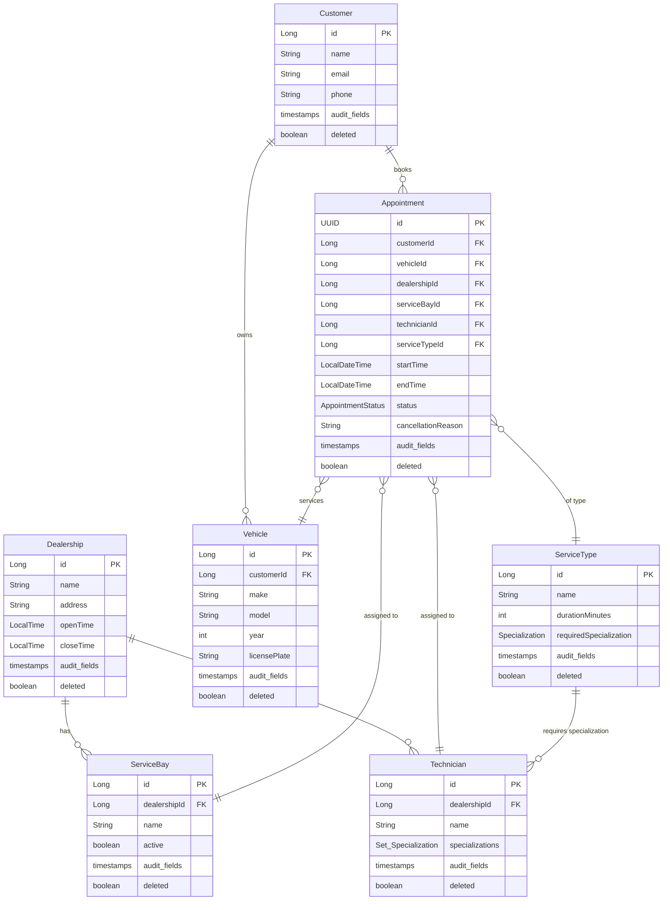
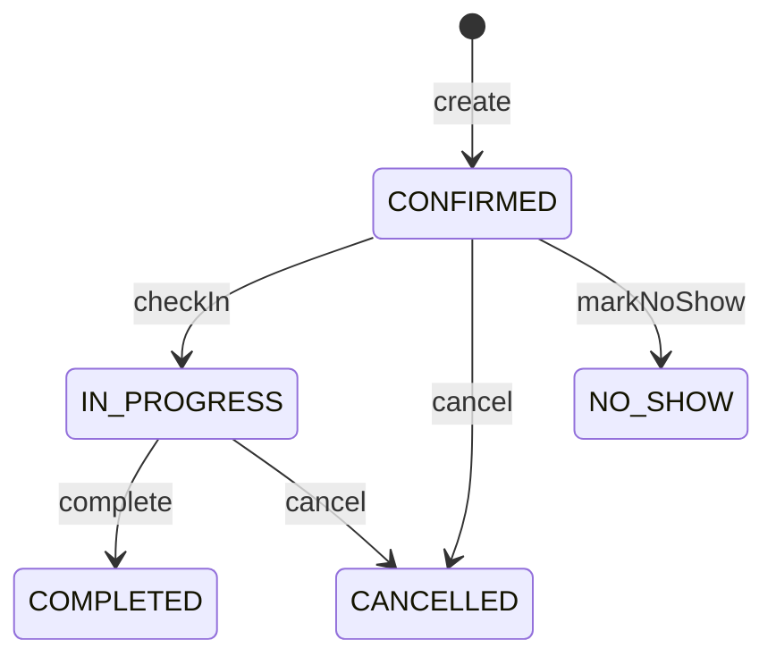

# 01. Requirements Analysis

---

## Table of Contents

- [1. Overview](#1-overview)
- [2. Core Entities](#2-core-entities)
- [3. Functional Requirements](#3-functional-requirements)
- [4. API Design](#4-api-design)
- [5. Business Rules & Constraints](#5-business-rules--constraints)
- [6. Assumptions](#6-assumptions)

---

## 1. Overview

**Scenario A — The Unified Service Scheduler** (Domain: Ownership)

A dealership network needs a scheduling system for vehicle service appointments. The system must handle resource-constrained booking (service bays + qualified technicians), prevent double-booking under concurrent load, and expose a clean REST API.

**Key challenges:**
- Each appointment requires **both** an available service bay **and** a qualified technician
- Concurrent booking requests must not result in double-booked resources
- The system must support multiple service types with different durations and specialization requirements

---

## 2. Core Entities



**Notes:**
- All entities inherit audit fields (`createdAt`, `updatedAt`, `createdBy`, `updatedBy`) via `AuditableEntity<TId>`
- All entities support soft delete (`deleted`, `deletedAt`) via `SoftDeletableEntity<TId>`
- `Appointment` uses `UUID` as its ID (generated via `UUID.randomUUID()`); all other entities use `Long`
- IDs are strongly-typed value objects: `AppointmentId(UUID)`, `CustomerId(Long)`, `VehicleId(Long)`, etc.
- `Specialization` is an enum: `GENERAL`, `BRAKES`, `ENGINE`

---

## 3. Functional Requirements

| ID | Requirement | Description |
|----|-------------|-------------|
| **FR1** | Check availability | Given a dealership, service type, and date, return all available time slots (bay + technician pairs) |
| **FR2** | Create appointment | Book an appointment with automatic bay/technician assignment; prevent double-booking via pessimistic locking |
| **FR3** | Cancel appointment | Cancel a confirmed or in-progress appointment with an optional reason |
| **FR4** | Check in | Transition appointment from `CONFIRMED` → `IN_PROGRESS` |
| **FR5** | Complete | Transition appointment from `IN_PROGRESS` → `COMPLETED` |
| **FR6** | Mark no-show | Transition appointment from `CONFIRMED` → `NO_SHOW` |
| **FR7** | Get appointment | Retrieve a single appointment by ID |
| **FR8** | Search appointments | Paginated search with filters (customerId, dealershipId, status, date range) and sort |

### Appointment State Machine



Valid transitions are enforced by `AppointmentStatus.canTransitionTo()` in the domain layer.

---

## 4. API Design

Base path: `/api/v1`

| Method | Endpoint | Description | Request Body | Key Headers |
|--------|----------|-------------|--------------|-------------|
| `GET` | `/dealerships/{id}/availability?serviceTypeId=&date=&pageIndex=0&pageSize=20` | Available slots (paged) | — | — |
| `POST` | `/appointments` | Create appointment | `CreateAppointmentRequest` | `Idempotency-Key` (required) |
| `GET` | `/appointments/{id}` | Get by ID | — | — |
| `DELETE` | `/appointments/{id}` | Cancel appointment | — | — |
| `PATCH` | `/appointments/{id}/check-in` | Check in | — | — |
| `PATCH` | `/appointments/{id}/complete` | Complete | — | — |
| `PATCH` | `/appointments/{id}/no-show` | Mark no-show | — | — |
| `GET` | `/appointments?customerId=&status=&pageIndex=0&pageSize=20&sortBy=startTime&sortDirection=ASC` | Search (paged) | — | — |

### Request/Response Examples

**Create Appointment Request:**
```json
{
  "customerId": 1,
  "vehicleId": 1,
  "dealershipId": 1,
  "serviceTypeId": 1,
  "startTime": "2025-03-20T09:00:00"
}
```

**Appointment Response (AppointmentDto):**
```json
{
  "id": "a1b2c3d4-...",
  "customerId": 1,
  "vehicleId": 1,
  "dealershipId": 1,
  "serviceBayId": 1,
  "technicianId": 1,
  "serviceTypeId": 1,
  "startTime": "2025-03-20T09:00:00",
  "endTime": "2025-03-20T10:00:00",
  "status": "CONFIRMED",
  "cancellationReason": null,
  "createdAt": "2025-03-19T15:30:00",
  "updatedAt": "2025-03-19T15:30:00"
}
```

**Paginated Response (PagedResult):**
```json
{
  "items": [ ... ],
  "totalCount": 42,
  "pageIndex": 0,
  "pageSize": 20,
  "totalPages": 3,
  "hasPrevious": false,
  "hasNext": true
}
```

### Error Responses

All errors follow **RFC 7807 ProblemDetail** format:

```json
{
  "type": "about:blank",
  "title": "Conflict",
  "status": 409,
  "detail": "Appointment.SlotNotAvailable",
  "instance": "/api/v1/appointments"
}
```

### Cross-Cutting Concerns

| Header | Purpose |
|--------|---------|
| `Idempotency-Key` | Required on `POST /appointments`. Prevents duplicate creation. 24h TTL with automatic cleanup. |
| `X-Correlation-ID` | Auto-generated UUID per request if not provided. Propagated via MDC for structured logging. |

---

## 5. Business Rules & Constraints

1. **Resource-constrained booking**: An appointment requires both a free service bay and a qualified technician for the entire duration
2. **Double-booking prevention**: Pessimistic locking (`SELECT ... FOR UPDATE`) on overlapping appointment checks
3. **Specialization matching**: Technicians must have the specialization required by the service type
4. **Operating hours**: Appointments must fall within the dealership's `openTime`–`closeTime` window
5. **Future dates only**: Appointments cannot be created in the past (enforced via `Clock` injection for testability)
6. **State transitions**: Only valid transitions are allowed (see state machine above); invalid transitions return a domain error
7. **Sort column whitelist**: Search endpoint validates `sortBy` against an allowed list to prevent SQL injection
8. **Soft delete**: Cancelled/deleted records remain in the database with `deleted = true`

---

## 6. Assumptions

1. **Single dealership per request** — availability and booking are scoped to one dealership at a time
2. **30-minute scheduling granularity** — time slots are generated at 30-minute intervals within operating hours
3. **No multi-service appointments** — each appointment has exactly one service type
4. **Seed data provided** — dealerships, bays, technicians, service types, customers, and vehicles are pre-seeded via Flyway migration (`V2__seed_data.sql`)
5. **No authentication** — the assessment focuses on domain logic, not user auth
6. **UTC timestamps** — all times stored and compared in UTC
7. **Single timezone** — no timezone conversion logic needed for this assessment scope

---

> **Navigation:** next → [`02-design.md`](./02-design.md) — High-Level Design + Deep Dives
