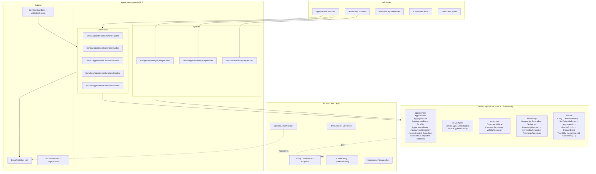
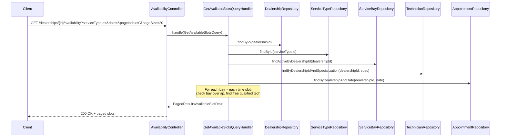
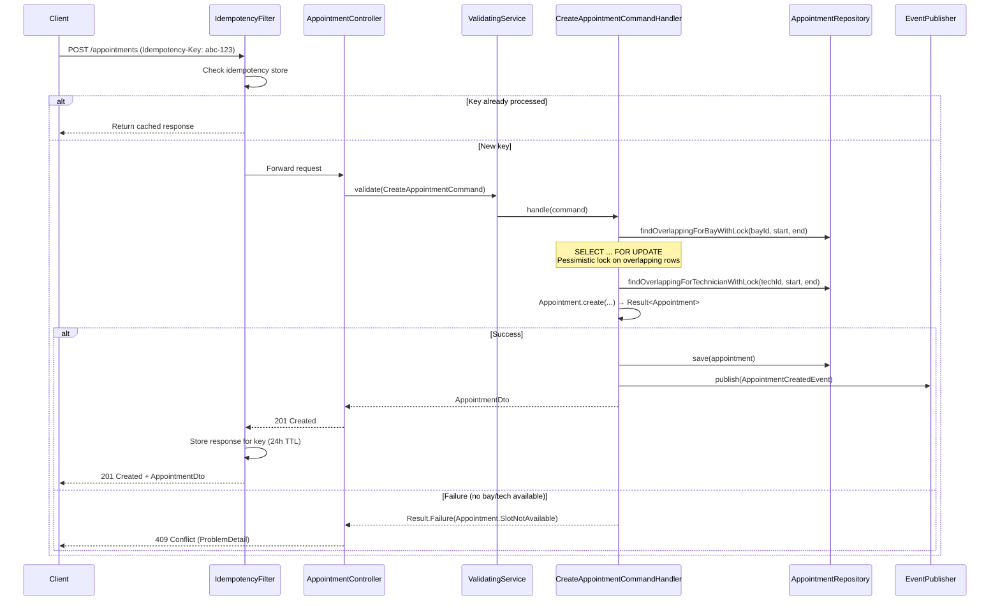
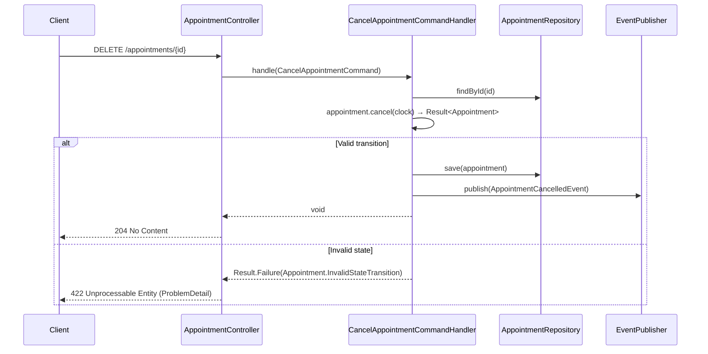
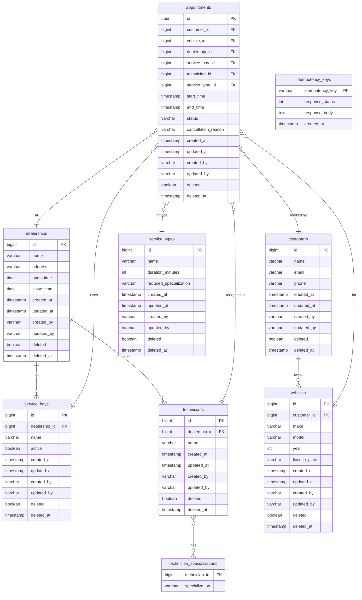

# 02. High-Level Design + Deep Dives

---

## Table of Contents

- [1. Architecture Overview](#1-architecture-overview)
- [2. Layer Responsibilities](#2-layer-responsibilities)
- [3. Key Patterns](#3-key-patterns)
- [4. Sequence Diagrams](#4-sequence-diagrams)
- [5. Deep Dive #1 — Contention & Double-Booking Prevention](#5-deep-dive-1--contention--double-booking-prevention)
- [6. Deep Dive #2 — Availability Calculation](#6-deep-dive-2--availability-calculation)
- [7. Deep Dive #3 — Observability](#7-deep-dive-3--observability)
- [8. Database Design (ERD)](#8-database-design-erd)
- [9. Final Architecture Diagram](#9-final-architecture-diagram)

---

## 1. Architecture Overview

The system follows **Clean Architecture** (4 layers) with **DDD** (package-by-aggregate) and **CQRS** (Command/Query separation at the application layer).



---

## 2. Layer Responsibilities

| Layer | Package | Responsibility | Dependencies |
|-------|---------|---------------|--------------|
| **API** | `api.controller`, `api.exception`, `api.request` | HTTP endpoints, request validation (`@Valid`), RFC 7807 error mapping | Application |
| **Application** | `application.appointment.command`, `.query`, `application.cqrs`, `.dto`, `.port`, `.validation` | CQRS handlers, orchestration, DTO mapping, validation pipeline | Domain |
| **Domain** | `domain.appointment`, `domain.servicetype`, `domain.customer`, `domain.dealership`, `domain.shared` | Entities, aggregates, value objects, repository interfaces, domain events, business rules | None (pure Java) |
| **Infrastructure** | `infrastructure.config`, `.event`, `.filter`, `.job`, `.persistence` | JPA entities, Spring Data repos, event publishing, filters, scheduled jobs | Domain (implements ports) |

**Dependency rule:** outer layers depend on inner layers, never the reverse. The domain layer has zero framework imports.

---

## 3. Key Patterns

### 3.1 CQRS

Commands and queries are separated at the application layer:

```java
public interface Command<R> {}
public interface CommandHandler<C extends Command<R>, R> {
    R handle(C command);
}

public interface Query<R> {}
public interface QueryHandler<Q extends Query<R>, R> {
    R handle(Q query);
}
```

- **Commands** mutate state: `CreateAppointmentCommand`, `CancelAppointmentCommand`, `CheckInAppointmentCommand`, `CompleteAppointmentCommand`, `NoShowAppointmentCommand`
- **Queries** are read-only: `GetAppointmentByIdQuery`, `SearchAppointmentsQuery`, `GetAvailableSlotsQuery`

### 3.2 Result Pattern (No Exceptions in Domain)

```java
public sealed interface Result<T> {
    record Success<T>(T value) implements Result<T> {}
    record Failure<T>(Error error) implements Result<T> {}
}

public record Error(String code, String message) {}
```

Domain methods return `Result<T>` instead of throwing exceptions. Error codes follow the format `"Entity.Reason"` (e.g., `"Appointment.SlotNotAvailable"`, `"Appointment.InvalidStateTransition"`).

### 3.3 Domain Events

Events are published when significant state changes occur:

| Event | Trigger |
|-------|---------|
| `AppointmentCreatedEvent` | New appointment created |
| `AppointmentCancelledEvent` | Appointment cancelled |
| `AppointmentCheckedInEvent` | Customer checked in |
| `AppointmentCompletedEvent` | Service completed |
| `AppointmentNoShowEvent` | Customer marked as no-show |

Events are collected on the `AggregateRoot` and published via `EventPublisher` (port) → `DomainEventPublisher` (adapter using Spring `ApplicationEventPublisher`).

### 3.4 Validation Pipeline

```
Request → @Valid (Bean Validation) → CommandValidator<T> → ValidatingService → CommandHandler
```

- `CommandValidator<T>` — interface for command-specific business validation
- `ValidatingService` — collects all validators for a command type, runs them, throws `ValidationException` if any fail
- `GlobalExceptionHandler` maps `ValidationException` → 400 with RFC 7807 ProblemDetail

### 3.5 Entity Hierarchy

```
Entity<TId>
  └── AuditableEntity<TId>        (createdAt, updatedAt, createdBy, updatedBy)
        └── SoftDeletableEntity<TId>  (deleted, deletedAt)
              └── AggregateRoot<TId>      (domainEvents list, registerEvent(), clearEvents())
```

---

## 4. Sequence Diagrams

### FR1 — Check Availability (Query)



### FR2 — Create Appointment (Command)



### FR3 — Cancel Appointment (Command)



---

## 5. Deep Dive #1 — Contention & Double-Booking Prevention

### Problem

Multiple concurrent requests for the same time slot could book the same bay or technician twice.

### Solution: Pessimistic Locking

```sql
-- Lock overlapping appointments for a specific bay
SELECT * FROM appointments
WHERE service_bay_id = :bayId
  AND status NOT IN ('CANCELLED', 'NO_SHOW')
  AND start_time < :endTime
  AND end_time > :startTime
  AND deleted = false
FOR UPDATE
```

**Flow:**
1. Transaction begins
2. `findOverlappingForBayWithLock()` — acquires row-level locks on all overlapping appointments for that bay
3. If no overlapping rows → bay is free
4. Repeat for technician with `findOverlappingForTechnicianWithLock()`
5. Create and save appointment
6. Transaction commits → locks released

**Why pessimistic over optimistic?**
- Booking conflicts are expected under load (limited bays/technicians)
- Pessimistic locking gives immediate, deterministic feedback
- No retry loops needed — if the lock is held, the thread waits
- PostgreSQL row-level locks are efficient for this pattern

### Concurrency Test Verification

The system is verified with:
- **Integration test**: 6 concurrent threads booking the same slot; at most 3 succeed (= number of bays), rest get 409
- **Gatling load test**: simulated ramp-up to verify no 500 errors under concurrent booking pressure

---

## 6. Deep Dive #2 — Availability Calculation

### Algorithm

```
Input: dealershipId, serviceTypeId, date
Output: List<AvailableSlotDto> (bay + technician + time)

1. Validate dealership and serviceType exist; date ≥ today
2. duration = serviceType.durationMinutes
3. Generate all possible start times:
   from dealership.openTime to (dealership.closeTime - duration)
   at 30-minute intervals
4. Fetch active service bays for the dealership
5. Fetch qualified technicians (matching serviceType.requiredSpecialization)
6. Fetch existing non-cancelled appointments for that date
7. For each bay × each start time:
     slot = TimeSlot(start, start + duration)
     if bay has no overlapping appointment:
       find first qualified tech with no overlapping appointment
       if found → add AvailableSlotDto to result
8. Sort by startTime
9. Apply pagination (OFFSET-based)
10. Return PagedResult<AvailableSlotDto>
```

### TimeSlot Overlap Check

```java
public record TimeSlot(LocalDateTime startTime, LocalDateTime endTime) {
    public boolean overlapsWith(TimeSlot other) {
        return this.startTime.isBefore(other.endTime)
            && this.endTime.isAfter(other.startTime);
    }
}
```

---

## 7. Deep Dive #3 — Observability

| Layer | Implementation | Details |
|-------|---------------|---------|
| **Correlation ID** | `CorrelationIdFilter` | Reads `X-Correlation-ID` header (or generates UUID); sets in MDC; echoes in response header |
| **Structured Logging** | SLF4J + Logback | `correlationId` in every log line via MDC; JSON-capable with Logstash encoder |
| **Idempotency** | `IdempotencyFilter` | Stores `Idempotency-Key` → response mapping; 24h TTL; `IdempotencyCleanupJob` runs scheduled cleanup |
| **Health Check** | Spring Boot Actuator | `/actuator/health` — database connectivity check |
| **Metrics** | Micrometer + Actuator | Appointments created, booking conflicts, API latency |
| **RFC 7807 Errors** | `GlobalExceptionHandler` | Maps domain errors, validation failures, and not-found to standard ProblemDetail responses |

### Error Mapping

| Exception / Error | HTTP Status | ProblemDetail `detail` |
|-------------------|-------------|------------------------|
| `ValidationException` | 400 | Field-level error messages |
| `MethodArgumentNotValidException` | 400 | Bean validation errors |
| `EntityNotFoundException` | 404 | Entity type + ID |
| `Appointment.SlotNotAvailable` | 409 | Slot not available message |
| `Appointment.InvalidStateTransition` | 422 | Current status → target status |
| `DuplicateIdempotencyKeyException` | 409 | Duplicate key |
| Unexpected exceptions | 500 | Generic message (details logged, not exposed) |

---

## 8. Database Design (ERD)



**Flyway Migrations:**
- `V1__create_schema.sql` — all tables, indexes, constraints
- `V2__seed_data.sql` — dealerships, bays, technicians, service types, customers, vehicles
- `V3__add_appointment_statuses.sql` — status check constraint
- `V4__create_idempotency_keys.sql` — idempotency key storage table
- `V5__add_audit_soft_delete_columns.sql` — audit and soft-delete columns on all tables

---

## 9. Final Architecture Diagram

```mermaid
graph TB
    subgraph Client
        HTTP[HTTP Client / Swagger UI]
    end

    subgraph Filters["Servlet Filters"]
        CIF[CorrelationIdFilter<br/>X-Correlation-ID → MDC]
        IDF[IdempotencyFilter<br/>Idempotency-Key → cache]
    end

    subgraph API["API Layer"]
        AC[AppointmentController<br/>POST, GET, DELETE, PATCH]
        AVC[AvailabilityController<br/>GET availability]
        GEH[GlobalExceptionHandler<br/>RFC 7807 ProblemDetail]
    end

    subgraph Application["Application Layer (CQRS)"]
        VS[ValidatingService<br/>CommandValidator pipeline]
        CMD["Command Handlers<br/>Create, Cancel, CheckIn,<br/>Complete, NoShow"]
        QRY["Query Handlers<br/>GetById, Search, AvailableSlots"]
        EP[EventPublisher port]
    end

    subgraph Domain["Domain Layer (Pure Java)"]
        AGG["Aggregates<br/>Appointment (root)<br/>ServiceType"]
        ENT["Entities<br/>Customer, Vehicle<br/>Dealership, ServiceBay, Technician"]
        VO["Value Objects<br/>AppointmentId, CustomerId, VehicleId<br/>TimeSlot, Specialization, AppointmentStatus"]
        EVT["Domain Events<br/>Created, Cancelled, CheckedIn<br/>Completed, NoShow"]
        RES["Result&lt;T&gt; / Error<br/>No exceptions in domain"]
        REPO_IF["Repository Interfaces<br/>(ports)"]
    end

    subgraph Infrastructure["Infrastructure Layer"]
        JPA["JPA Entities<br/>(separate from domain)"]
        REPO_IMPL["Spring Data Repositories<br/>+ Domain Adapters"]
        DEP[DomainEventPublisher<br/>Spring ApplicationEventPublisher]
        CLK[ClockConfig<br/>Deterministic time]
        AUD[JpaAuditConfig<br/>@CreatedDate, @LastModifiedDate]
        JOB[IdempotencyCleanupJob<br/>Scheduled 24h TTL cleanup]
    end

    subgraph DB["PostgreSQL 16"]
        PG[(Tables + Indexes<br/>Flyway V1-V5 migrations)]
    end

    HTTP --> CIF --> IDF --> API
    AC --> VS --> CMD
    AC --> QRY
    AVC --> QRY
    CMD --> AGG
    CMD --> EP
    QRY --> REPO_IF
    CMD --> REPO_IF
    AGG --> VO
    AGG --> EVT
    AGG --> RES
    REPO_IF -.->|implemented by| REPO_IMPL
    EP -.->|implemented by| DEP
    REPO_IMPL --> JPA
    JPA --> PG
```

---

> **Navigation:** next → [`03-tech-stack.md`](./03-tech-stack.md) — Technology Choices & Justifications
